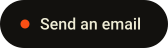
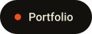
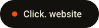

 

## About.

I've worked in tech since 2019. I started on the support desk, which taught me how software actually breaks for the people using it. Today I build the other side: fast, responsive and accessible interfaces with **React**, **Next.js** and **TypeScript**, connected to the APIs and services behind them.

At **Grupo In Press** I'm a front-end developer. I build web interfaces focused on performance and user experience, work on Next.js applications that talk to FastAPI services, and collaborate closely with design and product.

I'm going deeper on the back end with **Node.js**, **Python**, REST APIs, SQL and Docker. The goal is to understand an application end to end, from what the user sees to the business logic and the data underneath.

> Technology goes beyond writing code. It's understanding the problem, building a good experience and shipping something simple that's ready to grow.

 

## Journey.

 

## Click.

In 2026 I founded **Click.**, a digital studio that helps companies move their operations out of spreadsheets and manual processes. We design and build sites, web systems, apps and automations to order. I lead client work, solution architecture and development.

 

## Stack.

| Layer | Tools |
| :-- | :-- |
| **Front end** |  |
| **Back end** |  |
| **Data** |  |
| **Tools** |  |

 

## Selected work.

| Project | What it is |
| :-- | :-- |
| [**Click.**](https://www.clickconsultoriabr.com.br/) | The studio's website, where companies start a project with a diagnosis. |
| [**Portfolio**](https://thiagoservoli.vercel.app/) | My personal site, with projects and case studies. |
| **Senac student platform** | An app built at Senac to improve communication between students, made with React, JavaScript, HTML and CSS. |

 

## Activity.

<picture>
  <source media="(prefers-color-scheme: dark)" srcset="https://raw.githubusercontent.com/ThiagoServoli/ThiagoServoli/output/snake-dark.svg">
  <source media="(prefers-color-scheme: light)" srcset="https://raw.githubusercontent.com/ThiagoServoli/ThiagoServoli/output/snake-light.svg">
  
</picture>

 

## Contact.

  &nbsp;
  &nbsp;
  &nbsp;
  

