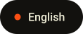
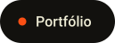

  &nbsp;
  

 

## Sobre.

Trabalho com tecnologia desde 2019. Comecei no suporte técnico, onde aprendi como o software quebra de verdade para quem usa. Hoje construo o outro lado: interfaces rápidas, responsivas e acessíveis com **React**, **Next.js** e **TypeScript**, conectadas às APIs e aos serviços por trás delas.

No **Grupo In Press** sou desenvolvedor front-end. Crio interfaces web com foco em performance e experiência do usuário, trabalho em aplicações Next.js integradas a serviços em FastAPI e atuo junto com os times de design e produto.

Estou me aprofundando no back-end com **Node.js**, **Python**, APIs REST, SQL e Docker. O objetivo é entender uma aplicação de ponta a ponta, da experiência visual à lógica de negócio e à camada de dados.

> Tecnologia vai muito além de escrever código. É entender problemas, construir boas experiências e desenvolver soluções simples, eficientes e preparadas para crescer.

 

## Trajetória.

 

## Click.

Em 2026 fundei a **Click.**, uma consultoria digital que ajuda empresas a tirar a operação das planilhas e dos processos manuais. Projetamos e construímos sites, sistemas web, aplicativos e automações sob medida. Lidero o atendimento aos clientes, a arquitetura das soluções e o desenvolvimento.

 

## Stack.

| Camada | Ferramentas |
| :-- | :-- |
| **Front-end** |  |
| **Back-end** |  |
| **Dados** |  |
| **Ferramentas** |  |

 

## Projetos.

| Projeto | O que é |
| :-- | :-- |
| [**Click.**](https://www.clickconsultoriabr.com.br/) | O site da consultoria, onde as empresas começam um projeto pelo diagnóstico. |
| [**Portfólio**](https://thiagoservoli.vercel.app/) | Meu site pessoal, com projetos e estudos de caso. |
| **Plataforma de alunos Senac** | Aplicativo criado no Senac para melhorar a comunicação entre os alunos, feito com React, JavaScript, HTML e CSS. |

 

## Atividade.

<picture>
  <source media="(prefers-color-scheme: dark)" srcset="https://raw.githubusercontent.com/ThiagoServoli/ThiagoServoli/output/snake-dark.svg">
  <source media="(prefers-color-scheme: light)" srcset="https://raw.githubusercontent.com/ThiagoServoli/ThiagoServoli/output/snake-light.svg">
  
</picture>

 

## Contato.

  &nbsp;
  &nbsp;
  &nbsp;
  

